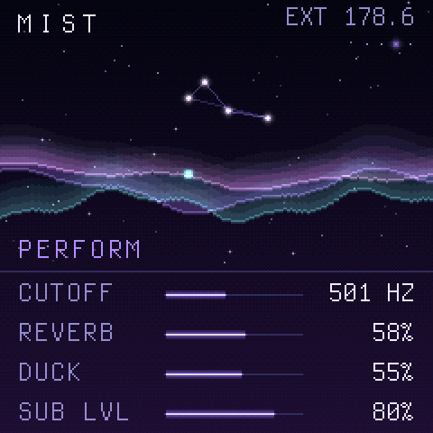
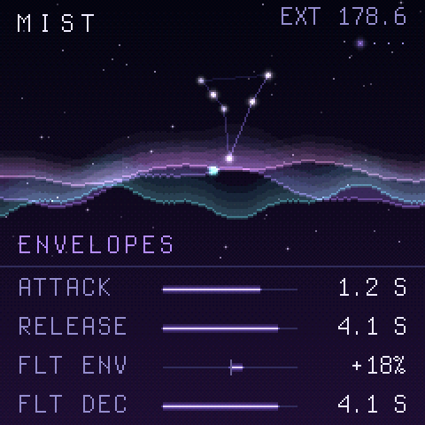
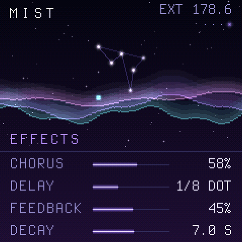
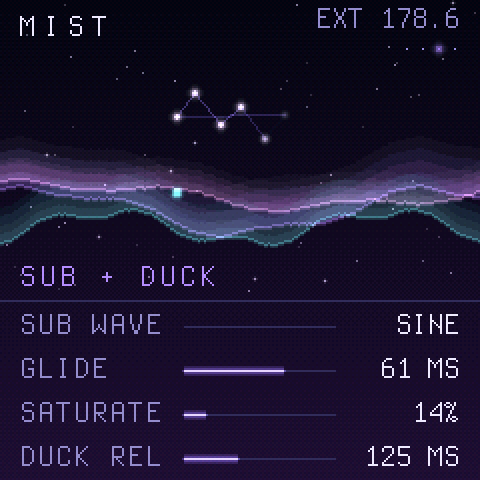
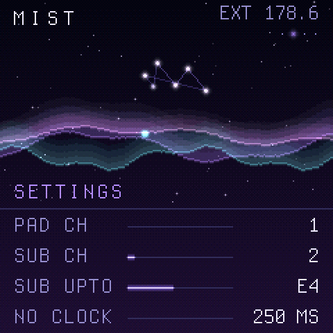
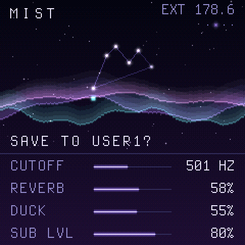

<p align="center"></p>

<p align="center"><b>Liquid drum and bass pads and sub bass, on the M-VAVE FM-1.</b></p>

Ethereal is open-source firmware for the M-VAVE FM-1 keyboard. It turns it into the half of a liquid drum and bass
track that a sampler or drum machine does not do well: a lush, slowly moving pad and a clean mono sub, both locked
to an external sequencer's MIDI clock. Play it from the FM-1's own keys or, as intended, from a sequencer over USB
or the TRS jack.

The pad is a 6-voice virtual analogue voice with chorus, a clock-synced ping-pong delay and a long reverb. The sub
is a separate mono voice with glide and saturation, kept dry. A sidechain-style duck pumps the pad on every beat
while the transport runs, and two LFOs move its filter and level in time with the bar. The screen is a night sky:
an aurora sways with the filter LFO and dims with the duck, and the notes you play appear as stars, each chord
drawing its own constellation.

<p align="center">
  
  
  
</p>

## Features

- **A pad built for liquid.** Two oscillators, saw or triangle each, up to 25 cents apart and drifting, with noise,
  a sub oscillator, a resonant filter with its own envelope, and envelopes up to 16 seconds. Six voices: a new note
  takes a free voice, else the quietest released one, else the oldest held, which fades out rather than clicks.
- **A sub that stays out of the way.** Mono, last-note priority, on its own MIDI channel. Sine, a sine with its
  octave added (it reads on small speakers) or triangle, with glide, soft saturation and velocity. No effects on it, so the low end stays tight.
- **Locked to the clock.** Ethereal follows MIDI clock and Start, Continue and Stop over USB or TRS, from 60 to 200
  BPM. The tempo is measured over up to four bars, so a jittery clock does not wobble the delay or the LFOs. If the
  clock drops, it carries on at the last tempo.
- **Movement in time.** The duck dips the pad on each beat or every two, with its depth, its release (in ms, or a
  16th or 8th of the clock) and a share for the sub. LFO 1 sweeps the cutoff over a quarter of a bar up to four
  bars; LFO 2 pulses the level in 16ths, 8th triplets, 8ths or quarters, as a sine, triangle or square.
- **Effects in time.** A stereo chorus, a ping-pong delay in 8ths, dotted 8ths, quarters or quarter triplets of
  the clock's tempo, and a large reverb with up to 12 seconds of decay, its own pre-delay, damping and send.
- **Five factory patches and four of your own.** MIST (a hospital-style wash), GLASS (soft and bell-like), HALO
  (swelling and wide), KEYS (Rhodes-like stabs) and STAB (short filtered chords for dub and garage). SAVE keeps
  the sound in one of four user slots; PRESETS or a Program Change picks one.
- **Controlled from the sequencer.** CC 20 to 43 turn the 24 knobs in page order, and the usual numbers work too:
  74 cutoff, 1 the cutoff LFO, 93 chorus, 94 duck, 5 glide, 73 attack, 72 release and 91 the reverb send. A CC
  changes the sound you hear but not the one saved, so a song's filter sweep never ends up in the patch.
- **The keys split.** The lowest 12 keys (F3 to E4, glowing) play the sub two octaves down and the rest play the
  pad. SEL makes them all pad, and the settings move the split point. PLAY latches a chord: let go and it holds,
  until the next chord replaces it.
- **Everything is kept.** The sound as the knobs left it, the user patches and the settings go to flash two
  seconds after the last change, once nothing is sounding.

## The FM-1's screens

| | | |
| :---: | :---: | :---: |
|  |  |  |
| **HOME:** cutoff, reverb, duck and the sub's level | **ENV:** the amp and filter envelopes | **FX:** chorus, delay and reverb |
|  |  |  |
| **GLO:** the sub's wave, glide and drive, the duck's release | **SELECT turned:** channels, the split, clock loss | **SAVE:** PRESETS picks the slot, SAVE again writes it |

The top bar shows the patch, the tempo (EXT when a clock comes in) and the beat. Below the sky, KNOB1 to KNOB4 edit
the four values on the page. The six pages:

| Button | Page | KNOB1 | KNOB2 | KNOB3 | KNOB4 |
| --- | --- | --- | --- | --- | --- |
| HOME | PERFORM | CUTOFF | REVERB | DUCK | SUB LVL |
| EDIT | PAD OSC | OSC | DETUNE | NOISE | SUB OCT |
| ENV | ENVELOPES | ATTACK | RELEASE | FLT ENV | FLT DEC |
| LFO | MODULATION | LFO1 | LFO1 AMT | LFO2 | LFO2 AMT |
| FX | EFFECTS | CHORUS | DELAY | FEEDBACK | DECAY |
| GLO | SUB + DUCK | SUB WAVE | GLIDE | SATURATE | DUCK REL |

## Getting started

1. **Install the firmware** on the FM-1, as in [Installing the firmware](#installing-the-firmware) below.
2. **Connect a sequencer** over USB or to the FM-1's MIDI TRS input. Send the pad's notes on channel 1 and the
   sub's on channel 2, and send MIDI clock with Start and Stop. Both channels can be changed in the settings.
3. **Pick a patch** with PRESETS, or send a Program Change: 0 to 4 are the factory patches, 5 to 8 the user slots.
4. **Shape it** with the page buttons and KNOB1 to KNOB4, or with CCs from the sequencer. Press SAVE, turn PRESETS
   to a user slot and press SAVE again to keep it.

The FM-1 also sends what it plays out over its USB audio, and the notes from its own keys over USB MIDI.

**Rescue:** if the FM-1 ever fails to start, hold **OCT-** while switching it on. It starts the USB updater only,
so a working firmware can be installed from there.

## Installing the firmware

There is no release yet. Until there is, build the firmware yourself as in
[docs/DEVELOPING.md](docs/DEVELOPING.md), which gives `build/ethereal.fwsc`, then install it with the FM-1 plugged
in over USB:

```sh
pip3 install mido python-rtmidi
python3 tools/fm1_install.py build/ethereal.fwsc
```

Close anything else that talks to the FM-1 over MIDI first. The installer asks before it writes anything, and the
FM-1 then restarts into Ethereal. `tools/fm1_install.py --info` shows what the connected FM-1 runs. If an install is
cut off, run the same command again and it finishes.

To go back to the official firmware or another one, use the
[FM-1 Firmware Hub](https://fm1.designburgapps.com) in Chrome or Edge.

## Disclaimer

Installing Ethereal, or any custom firmware, on an M-VAVE FM-1 is done entirely at the owner's own risk. It may void
the device's warranty, and an interrupted or faulty install could leave it unusable. Ethereal is provided "as is",
without warranty of any kind (see sections 15 and 16 of the [licence](LICENSE)). Its authors accept no
responsibility or liability for any damage to, or loss of use of, any device, or for any other loss arising from
installing or using it. If you are not comfortable with that, do not install it.

## Built with AI

Ethereal was developed with the help of AI: much of its code, tests and documentation were written by Claude
(Anthropic) under the author's direction, then reviewed and tested on a real FM-1 by the author. It may still
contain mistakes; reports and fixes are welcome.

## Documentation

| | |
| --- | --- |
| [docs/DEVELOPING.md](docs/DEVELOPING.md) | Building, the host simulator and the tests |
| [docs/RULES.md](docs/RULES.md) | The FM-1 chip's rules and what the build checks for |
| [docs/API.md](docs/API.md) | What the platform layer gives the app |

## Credits

Ethereal stands on the work of others:

- [Dinghy](https://github.com/zvenson/dinghy) by zvenson: the firmware base, host mode and build checks.
- [Felucca](https://github.com/hugelton/Felucca) by Leo Kuroshita (Hügelton Instruments), with the changes of
  [SLOOP](https://github.com/isod89/sloop-fm1) by isod89: the FM-1 platform (boot, USB, updates, audio, panel).
- The Terminus font by Dimitar Zhekov.

## Licence

GPL-3.0-only: you may use, study, change and share Ethereal, and whoever receives a firmware built from it must be
able to get its source. Third-party parts keep their own licences; see [LICENSING.md](LICENSING.md).

Ethereal is an independent project. It is not made, endorsed or supported by M-VAVE or the authors of the projects
above. M-VAVE and FM-1 belong to their owners.
